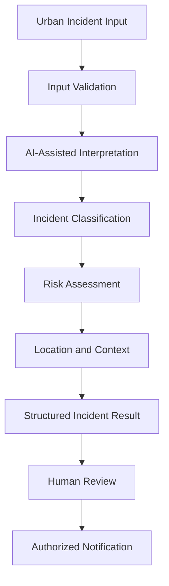
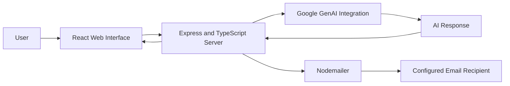

# 🌆 UrbanPulse AI — Multi-Agent Urban Intelligence Platform

> **AI-assisted urban intelligence for traffic, public safety, infrastructure monitoring, and emergency reporting.**

UrbanPulse AI is a project exploring how artificial intelligence and modern web technologies can support the identification, interpretation, and reporting of urban incidents. It aims to connect urban incident information with location-aware reporting and emergency communication through a unified application.

The project combines a React-based interface, a TypeScript/Express server, and Google's Generative AI SDK to explore AI-assisted urban intelligence workflows.

**Project Status:** Prototype / In Development

---

## 📌 Table of Contents

- [Overview](#-overview)
- [Problem Statement](#-problem-statement)
- [Objectives](#-objectives)
- [Key Features](#-key-features)
- [AI Model and Multi-Agent Architecture](#-ai-model-and-multi-agent-architecture)
- [System Architecture](#-system-architecture)
- [Technology Stack](#-technology-stack)
- [Project Structure](#-project-structure)
- [Installation and Setup](#-installation-and-setup)
- [Environment Configuration](#-environment-configuration)
- [Running the Application](#-running-the-application)
- [API Reference](#-api-reference)
- [Security and Limitations](#-security-and-limitations)
- [Future Enhancements](#-future-enhancements)
- [Contributing](#-contributing)
- [License](#-license)

---

## 🌍 Overview

Urban environments generate diverse information about road conditions, traffic incidents, infrastructure problems, and public safety concerns. Understanding and communicating this information efficiently can be challenging when information is fragmented across different reporting channels.

UrbanPulse AI explores an AI-assisted approach to organizing urban incident information and supporting faster communication.

The project's intended direction includes:

- AI-assisted interpretation of urban incident information.
- Exploration of camera-based and multimodal input.
- Location-aware incident reporting.
- Structured incident descriptions and severity information.
- Emergency email notifications through a server-side API.
- A foundation for future intelligent urban monitoring and decision-support features.

The project is intended as a software development and AI experimentation platform, not as a replacement for emergency services or authoritative public-safety systems.

## 🎯 Problem Statement

Traditional urban incident reporting can involve fragmented information, manual assessment, and delays in communicating important observations to the appropriate people.

A useful urban intelligence platform should help organize incident information, provide relevant context, support human decision-making, and make reporting workflows easier to manage.

UrbanPulse AI explores how AI-assisted analysis and web-based communication could contribute to this process.

## 🎯 Objectives

1. Explore AI-assisted interpretation of urban incidents.
2. Develop a web application using modern frontend and backend technologies.
3. Investigate location-aware urban reporting workflows.
4. Provide a backend mechanism for sending emergency-related email notifications.
5. Establish a foundation for modular AI services and future multi-agent orchestration.
6. Improve the accessibility and organization of urban incident information.

## ✨ Key Features

The following table distinguishes functionality visible in the repository from planned capabilities.

| Feature | Description | Status |
|---|---|---|
| Web application | React-based frontend served through Vite | Present in project configuration |
| TypeScript backend | Express server running with `tsx` | Present in source |
| Google GenAI integration | SDK dependency for generative AI functionality | Integration dependency present; complete model flow requires verification |
| Emergency email API | Express endpoint using Nodemailer | Route present; live delivery requires SMTP configuration |
| Location-aware functionality | Project metadata requests geolocation permission | Exact workflow requires verification |
| Camera and microphone access | Requested in project metadata | Actual capture and processing workflows require verification |
| Multi-agent orchestration | Intended architectural direction | Requires verification of agent implementation |
| Real-time traffic intelligence | Potential future capability | Not confirmed as implemented |
| Predictive urban risk analysis | Potential future capability | Not confirmed as implemented |

---

## 🧠 AI Model and Multi-Agent Architecture

UrbanPulse AI is intended to explore a modular AI workflow for urban incident intelligence.

### 1. AI model integration

The repository includes the `@google/genai` package, which provides a development dependency for integrating Google's generative AI services.

The actual model identifier, supported input modalities, prompts, response schema, and inference behavior should be documented after inspecting the application's AI implementation and configuration.

This project should not be described as having a custom-trained model unless a separate training pipeline and model artifacts are added.

### 2. Proposed multi-agent workflow

A modular architecture could separate the following responsibilities:

| Agent / Module | Intended responsibility |
|---|---|
| Input Processing | Validate and organize incident descriptions, images, and location information |
| Incident Understanding | Interpret available incident information using a configured AI model |
| Classification | Assign an incident category based on defined rules and model output |
| Risk Assessment | Evaluate severity using explicit criteria and available context |
| Location Intelligence | Associate incidents with a location when reliable location data is available |
| Notification | Prepare and dispatch authorized notifications through configured communication services |
| Coordination | Combine module outputs into a structured incident record for review |

**Important:** This table describes a proposed logical architecture. It does not establish that each agent is currently implemented as a separate executable component.

### 3. Proposed AI processing pipeline



The complete pipeline should be considered an architectural target until each stage is verified in the source code.

### 4. Model evaluation strategy

As the AI functionality develops, evaluate it using:

- Classification precision, recall, and F1-score.
- Per-category error analysis.
- Calibration and uncertainty handling.
- Performance across different lighting and image-quality conditions, where image analysis is supported.
- False-positive and false-negative rates.
- Inference latency and API reliability.
- Human-review requirements for ambiguous or safety-critical cases.

Do not report accuracy percentages or model benchmarks until they have been measured using a documented evaluation dataset.

---

## 🏗️ System Architecture

The current repository configuration supports a React/Vite frontend and a TypeScript/Express server. The intended AI integration can be connected through server-side application logic.



This diagram represents the intended application-level integration. It does not imply that all AI calls, classification steps, or production email workflows have been verified end to end.

### Component responsibilities

- **Frontend:** User interface and interaction.
- **Express server:** HTTP endpoints and server-side processing.
- **Google GenAI SDK:** Integration capability for configured generative AI services.
- **Nodemailer:** Email transport through configured SMTP credentials.
- **Environment configuration:** Stores API keys and communication credentials outside source code.

No database or persistent incident-storage system is documented here because its implementation has not been established from the visible files.

---

## 🛠️ Technology Stack

| Category | Technology |
|---|---|
| Frontend | React 19 |
| Programming language | TypeScript |
| Frontend tooling | Vite |
| Backend | Node.js and Express.js |
| AI integration | Google GenAI SDK (`@google/genai`) |
| Email communication | Nodemailer and SMTP |
| UI icons | Lucide React |
| Animation | Motion |
| Styling tools | Tailwind CSS 4 and its Vite integration |
| Environment variables | dotenv |
| Package management | npm |

The stack is based on the repository's package configuration. The presence of a dependency does not by itself confirm that every associated feature is implemented or enabled.

---

## 📂 Project Structure

The repository currently contains the following visible root-level files:

```text
URBAN-PULSE-AI/
├── README.md
├── package.json
├── package-lock.json
├── server.ts
├── index.html
├── metadata.json
├── tsconfig.json
├── vite.config.ts
├── .env.example
└── .gitignore
```

The filenames above use their conventional names. Rename the currently suffixed files in the repository to match them before following the commands below.

The application source referenced by `index.html` should also be included in the repository at its expected path, such as `src/main.tsx`, along with any components and styles required by the application.

---

## ⚙️ Installation and Setup

### Prerequisites

Install the following:

- Node.js and npm.
- Git.
- A Google GenAI API key if the AI functionality is enabled.
- SMTP credentials if you want to use the emergency email endpoint.

### Step 1: Clone the repository

```bash
git clone https://github.com/hiteshcv17/URBAN-PULSE-AI.git
cd URBAN-PULSE-AI
```

### Step 2: Correct the filenames

Ensure the repository uses these conventional filenames:

```text
README.md
package.json
package-lock.json
server.ts
index.html
metadata.json
tsconfig.json
vite.config.ts
.env.example
```

If the files currently include `[1]` in their names, rename them accordingly. Also verify that the frontend source files referenced by `index.html` exist.

### Step 3: Install dependencies

```bash
npm install
```

After the package and lock files are correctly named and synchronized, you can use `npm ci` for reproducible installations.

### Step 4: Configure environment variables

Create a local `.env` file in the project root. Add the configuration required for the features you intend to run.

Example:

```dotenv
GEMINI_API_KEY=your_google_genai_api_key

SMTP_HOST=smtp.gmail.com
SMTP_PORT=587
SMTP_USER=your_email@example.com
SMTP_PASS=your_email_app_password

EMERGENCY_EMAIL_RECIPIENT=authorized_recipient@example.com
```

Use actual credentials only in your local, ignored `.env` file or in your deployment provider's secret manager. Never commit real API keys or email passwords.

### Step 5: Start the development server

```bash
npm run dev
```

Open:

```text
http://localhost:3000
```

The configured Express server runs on port `3000` and uses Vite middleware for development.

**Troubleshooting:** If startup fails, verify the filenames, package installation, frontend entry point, environment configuration, and terminal error messages. The README and package files must match the actual source layout.

---
## 🔌 API Reference

### Emergency email notification

**Endpoint:** `POST /api/send-emergency-email`

**Purpose:** Send an emergency-related email using the configured SMTP transport.

Example request:

```json
{
  "location": "Example location",
  "description": "An urban incident requiring review",
  "severity": "high"
}
```

Optional request fields supported by the current route include:

- `recipient`
- `numberPlate`
- `reporterName`

Example success response:

```json
{
  "success": true,
  "message": "Emergency email sent successfully."
}
```

The success response is returned only after the server's email-send operation resolves successfully.

The route requires `location`, `description`, and `severity`. Missing required fields produce a `400` response. Email configuration or delivery failures may produce a `500` response.

**Security note:** The current route accepts a recipient override from request data. Before exposing it publicly, restrict recipient selection, validate request fields, escape user-supplied HTML, implement rate limiting, and add appropriate authentication or authorization.

No other API endpoints are documented here because their existence and behavior have not been verified.

---

## 🔐 Security and Limitations

UrbanPulse AI is a prototype and should not be used as an authoritative emergency dispatch system.

Before deploying it publicly:

- Store API keys and SMTP credentials in server-side environment variables.
- Validate all incoming request data.
- Escape user-provided content before inserting it into HTML emails.
- Restrict the emergency email recipient to authorized destinations.
- Add rate limiting and abuse prevention.
- Avoid exposing credentials or sensitive incident details in logs.
- Add authentication and authorization wherever required.
- Treat AI-generated classifications and severity estimates as advisory.
- Verify AI responses before using them in safety-related workflows.
- Provide human review for uncertain or high-impact decisions.
- Test API failures, invalid inputs, and email delivery failures.

AI outputs can be incomplete or incorrect. The system must not be relied upon to make autonomous emergency decisions without appropriate verification and safeguards.

---

## 🚀 Future Enhancements

Potential development directions include:

- Implementing and documenting distinct AI agents with clearly defined responsibilities.
- Adding structured incident classification and explainable risk scoring.
- Integrating verified geospatial and mapping services.
- Developing a live incident dashboard when reliable data sources are available.
- Adding incident history and persistence through a suitable database.
- Introducing authentication and role-based access control.
- Adding evidence upload validation and privacy protections.
- Creating an audit trail for AI-assisted decisions.
- Building a test suite for API routes and model outputs.
- Evaluating model behavior with documented datasets and reproducible metrics.
- Adding deployment automation, monitoring, and health checks.

These items are planned enhancements, not claims about existing functionality.

---

## 🧪 Testing and Validation

Before declaring a release ready, verify:

- The application installs from a clean checkout.
- The development and production commands work.
- The frontend entry point and all required assets load.
- The AI integration handles missing credentials and provider errors.
- The email endpoint rejects invalid input.
- Email delivery is tested using an authorized recipient.
- Secrets are not exposed in the frontend bundle or Git history.
- TypeScript checks and production builds complete successfully.
- The application works at mobile and desktop screen sizes.

Add automated tests as the corresponding modules become available.

---

## 🤝 Contributing

Contributions that improve architecture, reliability, documentation, accessibility, and responsible AI behavior are welcome.

1. Fork the repository.
2. Create a feature branch.
3. Make focused changes.
4. Test the changes locally.
5. Update the documentation.
6. Submit a pull request explaining the implementation and verification performed.

Please do not include API keys, passwords, private incident data, or other sensitive information in commits or issue reports.

---

## 👨‍💻 Author

**Hitesh C V**

- GitHub: [@hiteshcv17](https://github.com/hiteshcv17)
- Project repository: [URBAN-PULSE-AI](https://github.com/hiteshcv17/URBAN-PULSE-AI)

---

## 📄 License

A license has not been verified from the currently visible repository files. Add a `LICENSE` file and update this section once you have selected a license.

---

*UrbanPulse AI — Exploring AI-assisted intelligence for safer, smarter, and more responsive urban environments.*

